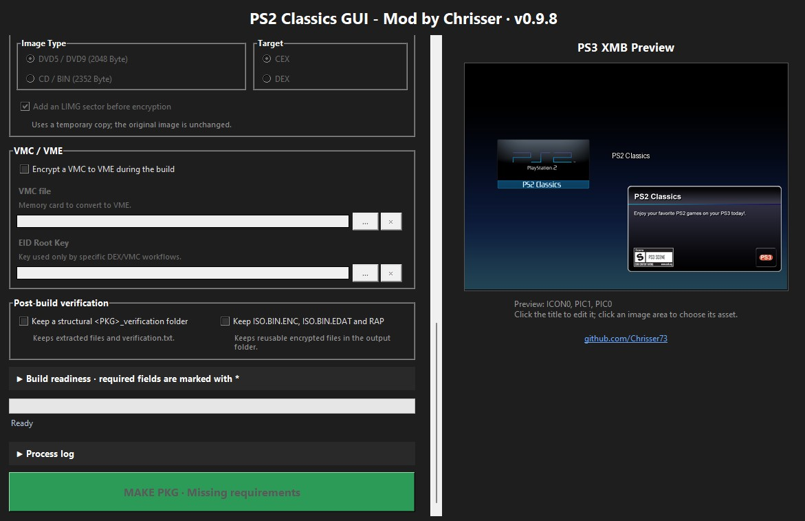

<p align="center">
  
</p>

<h1 align="center">PS2 Classics GUI - Mod by Chrisser</h1>

<p align="center">
  A modern Python/Tkinter front-end for PS2 Classics GUI v2.2.3, with a live
  XMB preview, automatic metadata and CONFIG detection, local key restoration,
  build-readiness checks and a Windows EXE builder.
</p>

The original Visual Basic 5 front-end can crash on modern Windows systems
while selecting or processing files. This project replaces only that legacy
interface and continues to use the original toolchain installed locally by
the user.

## Preview



## Setup

### Requirements

- Windows 10 or Windows 11
- [PS2 Classics GUI v2.2.3 by Aldo Vargas](https://www.psx-place.com/resources/ps2-classics-gui.638/)
- Python 3 with Tkinter and Tcl/Tk
- Pillow
- PyInstaller only when building the EXE

Install the Python packages:

```bat
py -3 -m pip install --upgrade Pillow PyInstaller
```

### Installation

1. Download and extract the original `ps2classics_GUI_2.2.3` package.
2. Copy these files into the root of that folder:
   - `ps2_classics_gui_mod.py`
   - `start.bat`
   - `build.bat`
   - `app.ico`
   - `app.png`
3. Keep the original package files and folders in place.

The mod automatically detects and reuses the locally installed tools,
templates, CONFIG files, covers and key files.

## How to run

Start the source version with:

```bat
start.bat
```

or:

```bat
py -3 ps2_classics_gui_mod.py
```

The normal workflow is handled through the GUI. No terminal commands are
required for package creation.

## Building the Windows EXE

Make sure Python 3, pip, Tkinter/Tcl-Tk, Pillow and PyInstaller are installed,
then run:

```bat
build.bat
```

The finished EXE is written to:

```text
_build\
```

Copy the generated EXE from `_build` into the root of
`ps2classics_GUI_2.2.3` before using it normally.

The EXE includes Python, Tkinter and Pillow. The original PS2 Classics GUI
toolchain remains external and must still be present in the same installation.

## Notes

- The GUI searches the original installation for the files required by each
  workflow.
- Missing requirements are shown in the collapsible build-readiness panel.
- A matching PS2 CONFIG is inserted automatically when one is found.
- Existing local key material can be detected, restored to the project root,
  validated and reused automatically.
- The application does not store machine-specific paths in a settings file.

## Legal notice

This repository contains only the replacement front-end, its own assets,
documentation and build scripts. It does not provide the original toolchain
or third-party/proprietary content.

This is an unofficial community project and is not affiliated with or
endorsed by Sony Interactive Entertainment, Aldo Vargas or the authors of the
external tools it can call.

Use the software only with content, backups, tools, keys and licenses that you
are legally authorized to use. This project is not intended for piracy or
unlawful circumvention, and the author expressly distances himself from such
use.
